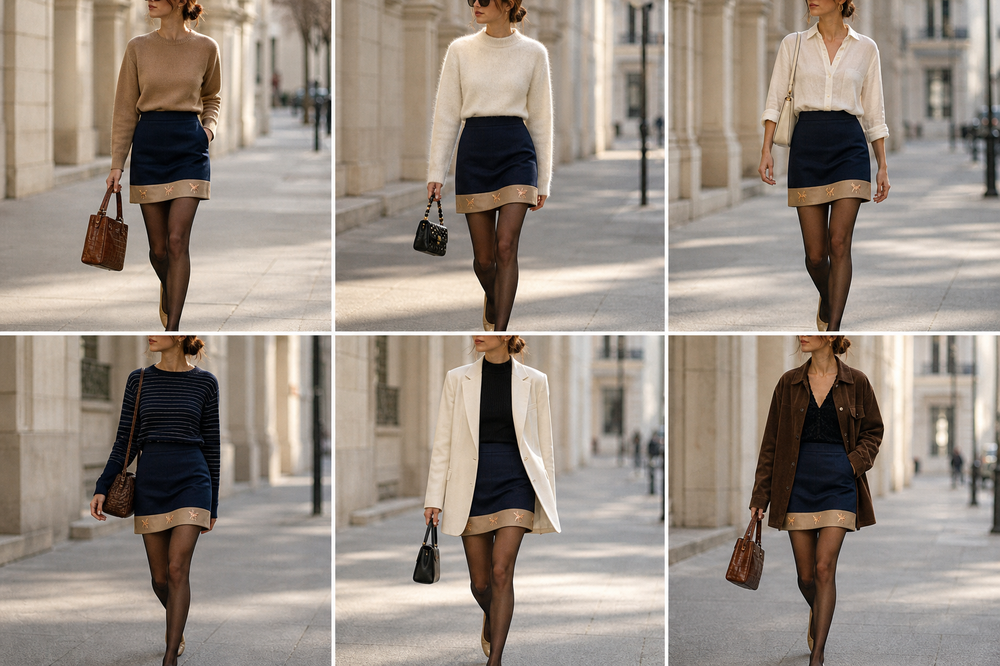

# Saia curta com barra de pégasos (Lança Perfume) — street style

Peça âncora: **SAI-04**, com as peças e bolsas dela. Gerada pela API.

| # | Look | Combinação | ⭐ |
|---|---|---|---|
| 1 | Pégasos e camelo | SUE-12, BOL-02, Meia-calça fina preta | |
| 2 | Pégasos e suéter creme | SUE-03, BOL-06, Meia-calça fina preta | |
| 3 | Pégasos e camisa branca | CAM-10, BOL-05, Meia-calça fina preta | |
| 4 | Pégasos e listrado marinho | SUE-07, BOL-02, Meia-calça fina preta | |
| 5 | Pégasos e blazer creme | BLU-33, BLA-08, BOL-04, Meia-calça fina preta | |
| 6 | Pégasos e casaco chocolate | CAS-04, BOL-02, Meia-calça fina preta | |
