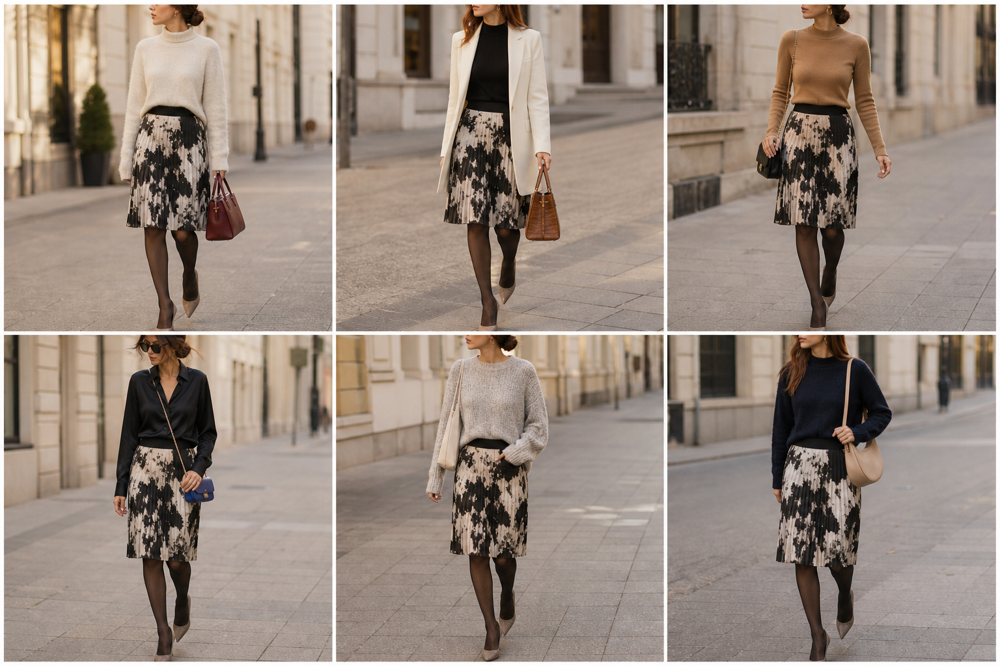

# Saia micro plissada preto e off-white — street style

Peça âncora: **SAI-09**, com as peças e bolsas dela. Gerada pela API.

| # | Look | Combinação | ⭐ |
|---|---|---|---|
| 1 | Plissada e suéter creme | SUE-03, BOL-01, Meia-calça fina preta | |
| 2 | Plissada e blazer creme | BLU-33, BLA-08, BOL-02, Meia-calça fina preta | |
| 3 | Plissada e camelo | SUE-12, BOL-06, ACE-03, Meia-calça fina preta | |
| 4 | Plissada e camisa preta | CAM-05, BOL-03, Meia-calça fina preta | |
| 5 | Plissada e chenille | SUE-09, BOL-05, Meia-calça fina preta | |
| 6 | Plissada e marinho | SUE-02, BOL-08, Meia-calça fina preta | |
