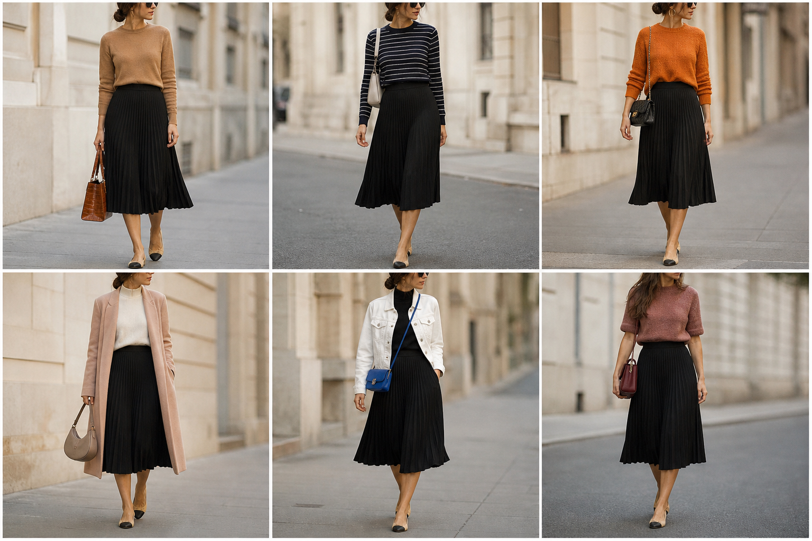

# Saia plissada preta midi — street style

Peça âncora: **SAI-10**, com as peças e bolsas dela. Gerada pela API.

| # | Look | Combinação | ⭐ |
|---|---|---|---|
| 1 | Plissada preta e camelo | SUE-12, BOL-02 | |
| 2 | Plissada preta e listras | SUE-07, BOL-05 | |
| 3 | Plissada preta e laranja | SUE-06, BOL-06, ACE-03 | |
| 4 | Plissada preta e sobretudo rosa | SUE-03, CAS-07, BOL-08 | |
| 5 | Plissada preta e jaqueta branca | BLU-33, JAQ-04, BOL-03 | |
| 6 | Plissada preta e rosa queimado | SUE-11, BOL-01 | |
