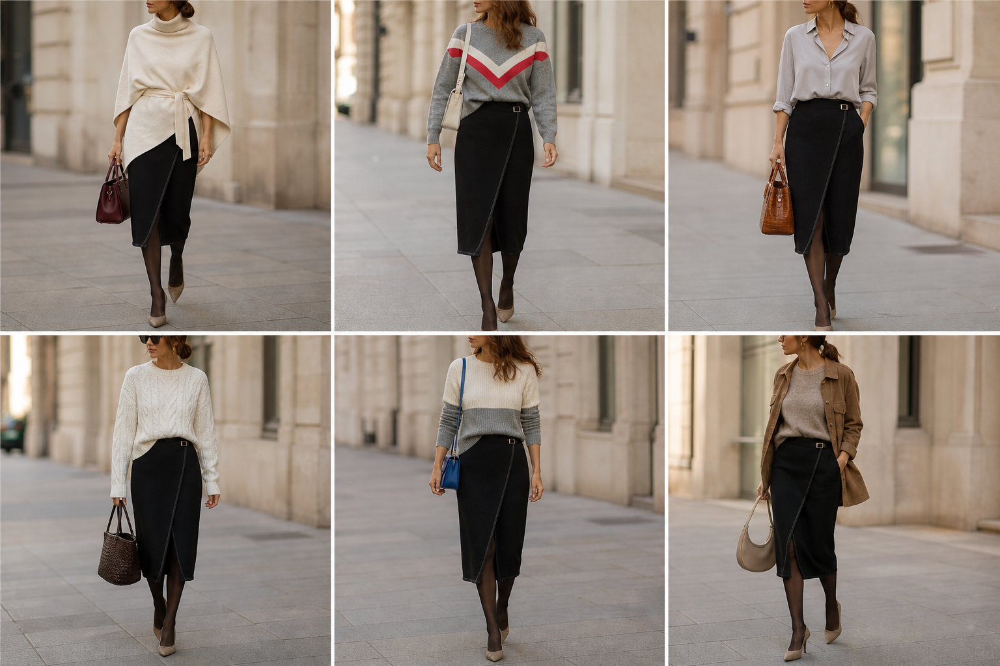

# Saia preta transpassada (Max Mara) — street style

Peça âncora: **SAI-08**, com as peças e bolsas dela. Gerada pela API.

| # | Look | Combinação | ⭐ |
|---|---|---|---|
| 1 | Max Mara e capa creme | CAS-06, BOL-01, Meia-calça fina preta | |
| 2 | Max Mara e chevron | SUE-04, BOL-05, Meia-calça fina preta | |
| 3 | Max Mara e camisa perolada | CAM-07, BOL-02, ACE-03, Meia-calça fina preta | |
| 4 | Max Mara e tranças | SUE-08, BOL-07, Meia-calça fina preta | |
| 5 | Max Mara e color block | SUE-13, BOL-03, Meia-calça fina preta | |
| 6 | Max Mara e camurça | SUE-01, JAQ-03, BOL-08, Meia-calça fina preta | |
