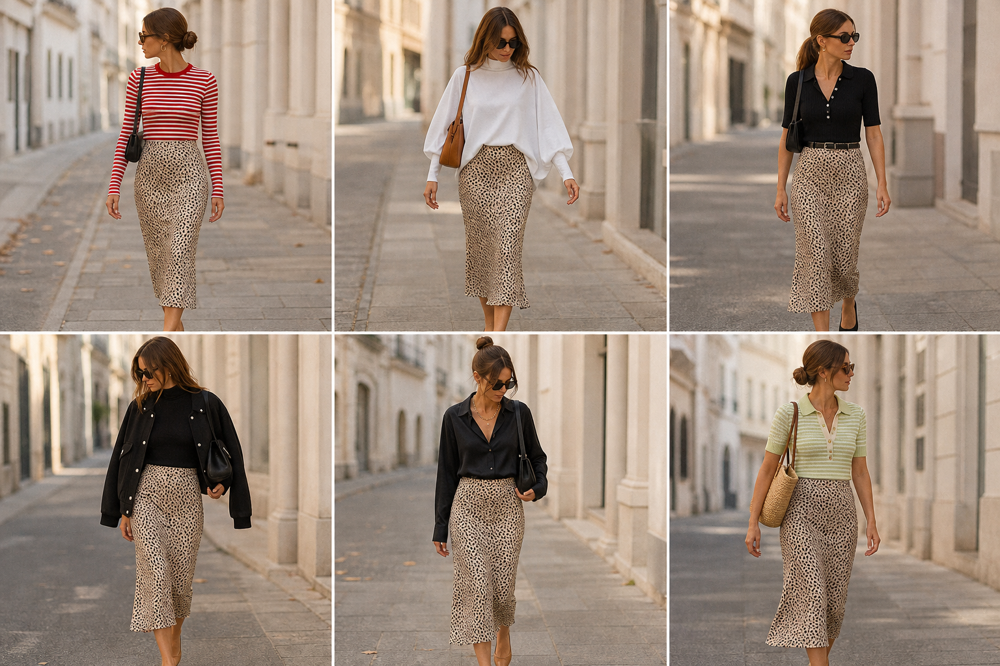

# Saia slip animal print (H&M) — street style

Peça âncora: **SAI-02**, com as blusas que ela já tem. Gerada automaticamente pela API (gpt-image-2).
Prompt: [saia slip animal print](../../prompts/2026-11-07-saia-slip-animal-print-street-style.md).

| # | Look | Combinação (além da saia) | ⭐ |
|---|---|---|---|
| 1 | Listrada | Camiseta listrada vermelha (BLU-10) + bolsa preta | |
| 2 | Wingsuit | Blusa Wingsuit branca (BLU-14) + bolsa caramelo | |
| 3 | Polo preta | Polo com botões preta (BLU-12) + cinto preto | |
| 4 | Bomber | Gola alta preta + jaqueta bomber (JAQ-02) | |
| 5 | Camisa acetinada | Camisa acetinada preta (CAM-05) + colar dourado | |
| 6 | Polo pistache | Polo Erica Candy (BLU-11) + bolsa de palha | |
