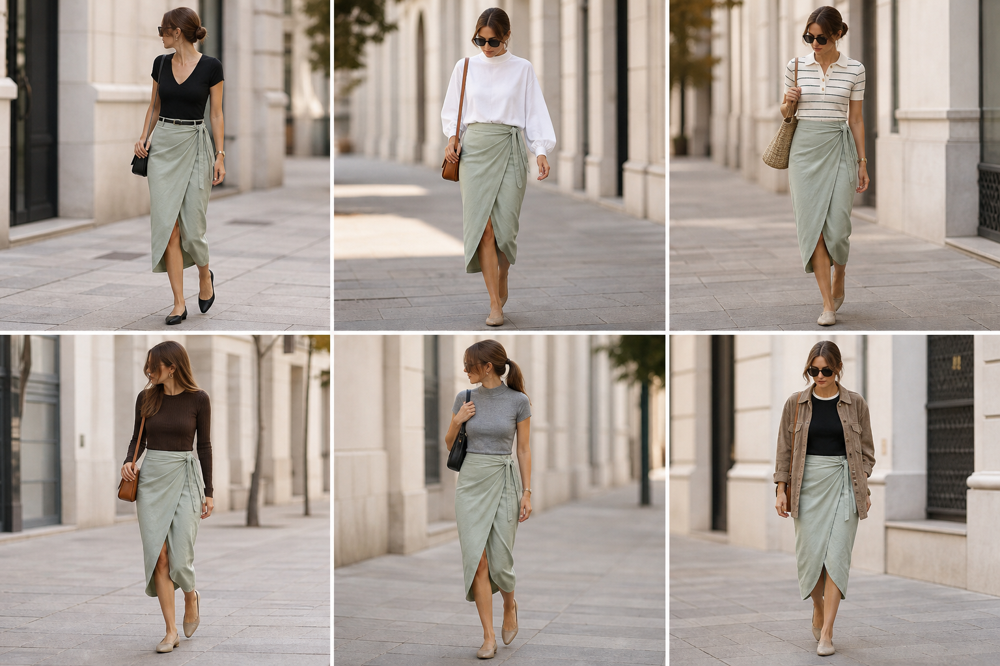

# Saia midi transpassada de linho verde-menta — street style

Peça âncora: **SAI-03**, com as peças dela. Gerada pela API.
Prompt: [prompt](../../prompts/2026-11-08-saia-transpassada-verde-street-style.md).

| # | Look | Combinação | ⭐ |
|---|---|---|---|
| 1 | Verde e decote V | BLU-22, ACE-02, Bolsa preta pequena | |
| 2 | Verde e Wingsuit | BLU-14, Bolsa caramelo | |
| 3 | Verde e polo mescla | BLU-11, Bolsa de palha | |
| 4 | Verde e tricô marrom | BLU-15, ACE-03, Bolsa caramelo | |
| 5 | Verde e gola alta cinza | BLU-18, Bolsa preta | |
| 6 | Verde, debrum e camurça | BLU-17, JAQ-03 | |
