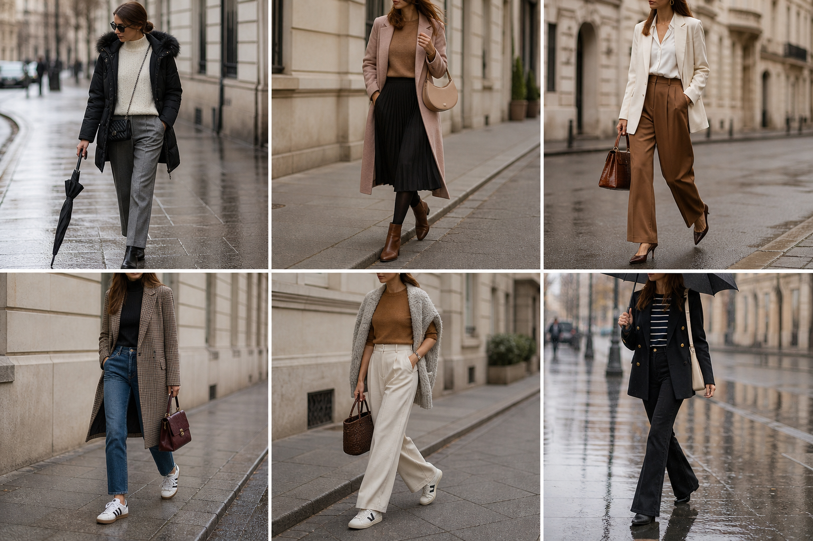

# Semana 9–13 de novembro (Curitiba)

Previsão (Simepar/INMET/BRA1, consultada em 8/11): seg 17°/10° chuva · ter 18°/10° · qua 22°/13° · qui 25°/13° chance de chuva · sex sem previsão (estimado quente).

| Dia | Look | Peças |
|---|---|---|
| Segunda | Segunda · frio e chuva | SUE-03, CAL-18, CAS-02, BOL-06, Bota preta |
| Terça | Terça · fresco | SUE-12, SAI-10, CAS-07, BOL-08, Meia-calça fina preta, Bota marrom |
| Quarta | Quarta · ameno | CAM-10, CAL-17, BLA-08, SAP-02, BOL-02, ACE-03 |
| Quinta | Quinta · quente, chance de chuva | BLU-33, CAL-14, BLA-06, BOL-01, Tênis Samba |
| Sexta | Sexta · quente e casual | BLU-38, CAL-03, CAS-08, BOL-07, Tênis Veja |
| Plano B | Plano B · chuva forte | SUE-07, CAL-15, BLA-05, BOL-05, Bota preta |
