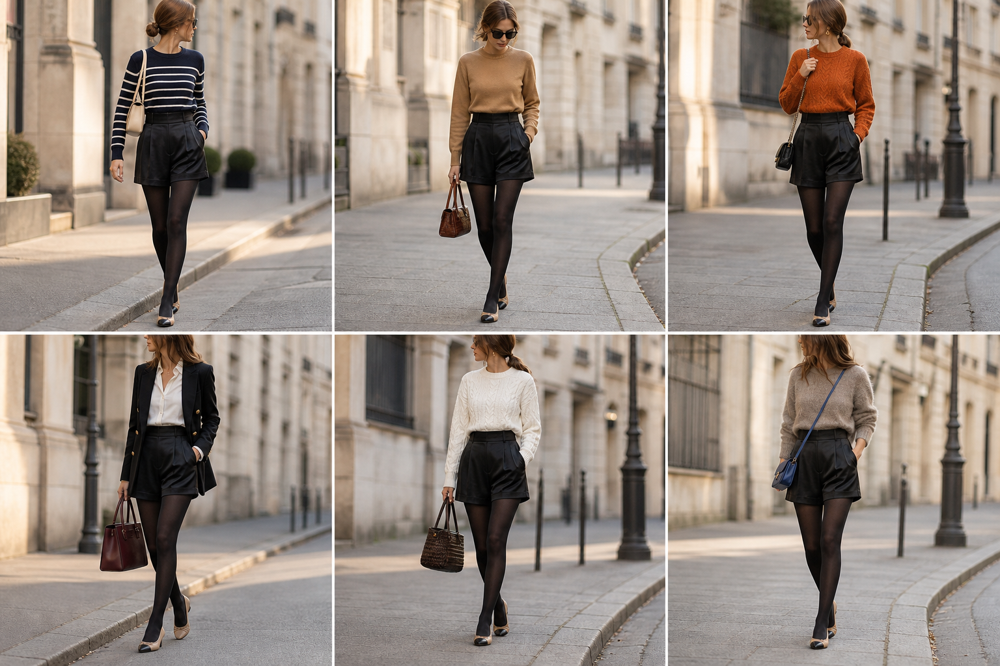

# Short acetinado preto (Calvin Klein) — street style

Peça âncora: **CAL-10**, com as peças e bolsas dela. Gerada pela API.

| # | Look | Combinação | ⭐ |
|---|---|---|---|
| 1 | Short preto e listrado | SUE-07, BOL-05, Meia-calça preta opaca | |
| 2 | Short preto e camelo | SUE-12, BOL-02, Meia-calça preta opaca | |
| 3 | Short preto e laranja | SUE-06, BOL-06, ACE-03, Meia-calça preta opaca | |
| 4 | Short preto, camisa e blazer | CAM-10, BLA-05, BOL-01, Meia-calça preta opaca | |
| 5 | Short preto e tranças | SUE-08, BOL-07, Meia-calça preta opaca | |
| 6 | Short preto e taupe | SUE-01, BOL-03, Meia-calça preta opaca | |
