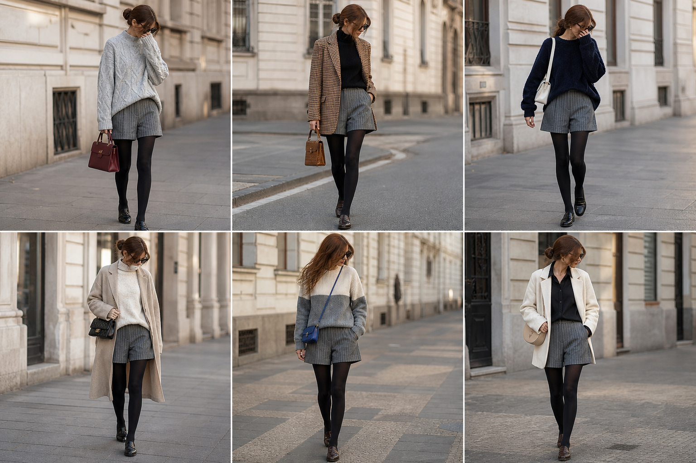

# Short de alfaiataria risca de giz — street style

Peça âncora: **CAL-09**, com as peças e bolsas dela. Elástico atrás coberto por blusa por fora ou terceira peça longa. Gerada pela API.

| # | Look | Combinação | ⭐ |
|---|---|---|---|
| 1 | Short e chenille | SUE-09, BOL-01, Meia-calça preta opaca | |
| 2 | Short e pied-de-poule | BLU-33, BLA-06, BOL-02, Meia-calça preta opaca | |
| 3 | Short e marinho felpudo | SUE-02, BOL-05, Meia-calça preta opaca | |
| 4 | Short e casaco bege | SUE-03, CAS-03, BOL-06, Meia-calça preta opaca | |
| 5 | Short e color block | SUE-13, BOL-03, Meia-calça preta opaca | |
| 6 | Short e blazer creme | CAM-05, BLA-08, BOL-08, ACE-03, Meia-calça preta opaca | |
