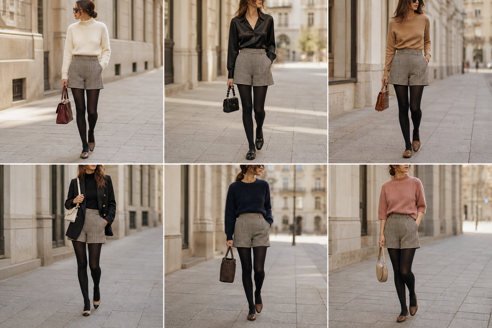

# Short de alfaiataria xadrez — street style

Peça âncora: **CAL-11**, com as peças e bolsas dela. Gerada pela API.

| # | Look | Combinação | ⭐ |
|---|---|---|---|
| 1 | Xadrez e suéter creme | SUE-03, BOL-01, Meia-calça preta opaca | |
| 2 | Xadrez e camisa preta | CAM-05, BOL-06, ACE-03, Meia-calça preta opaca | |
| 3 | Xadrez e camelo | SUE-12, BOL-02, Meia-calça preta opaca | |
| 4 | Xadrez e blazer preto | BLU-33, BLA-05, BOL-05, Meia-calça preta opaca | |
| 5 | Xadrez e marinho | SUE-02, BOL-07, Meia-calça preta opaca | |
| 6 | Xadrez e rosa queimado | SUE-11, BOL-08, Meia-calça preta opaca | |
