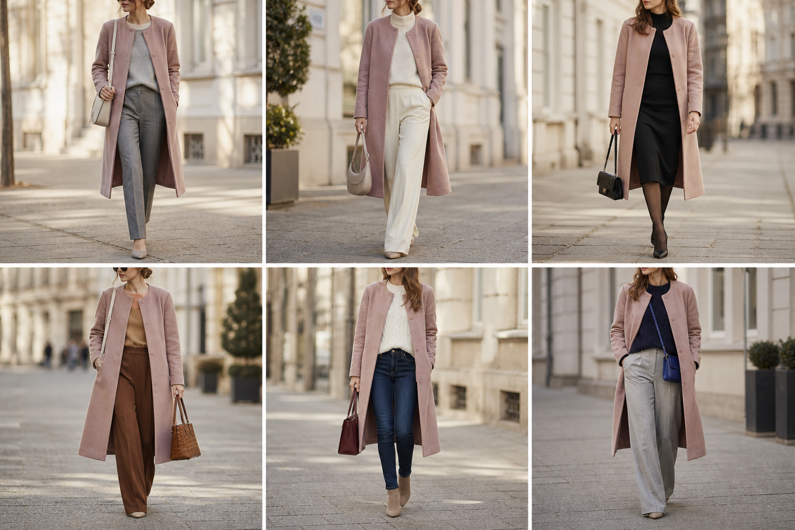

# Sobretudo rosa antigo (Lauren Ralph Lauren) — street style

Peça âncora: **CAS-07**, com as peças e bolsas dela. Gerada pela API.

| # | Look | Combinação | ⭐ |
|---|---|---|---|
| 1 | Rosa e cinza | SUE-09, CAL-18, BOL-05 | |
| 2 | Rosa e tudo creme | SUE-03, CAL-03, BOL-08 | |
| 3 | Rosa e preto | BLU-33, SAI-05, BOL-06, Meia-calça fina preta | |
| 4 | Rosa e marrom canela | SUE-12, CAL-17, BOL-02 | |
| 5 | Rosa e jeans | SUE-08, CAL-14, BOL-01 | |
| 6 | Rosa e marinho | SUE-02, CAL-04, BOL-03 | |
