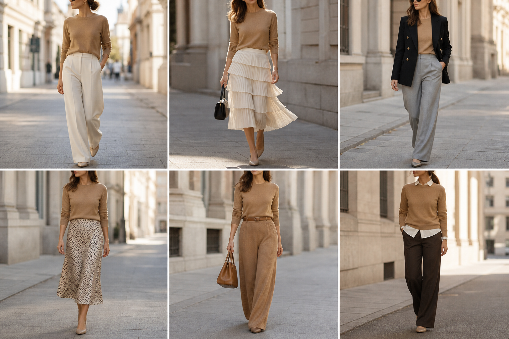

# Suéter camelo (Shoulder) — street style

Peça âncora: **SUE-12**, com as peças dela. Gerada pela API.

| # | Look | Combinação | ⭐ |
|---|---|---|---|
| 1 | Camelo e off-white | CAL-03, ACE-03 | |
| 2 | Camelo e saia creme | SAI-01, Bolsa preta pequena | |
| 3 | Camelo e blazer preto | BLA-05, CAL-04 | |
| 4 | Camelo e slip | SAI-02 | |
| 5 | Camelo tom sobre tom | CAL-06, Bolsa caramelo, Cinto marrom | |
| 6 | Camelo e camisa | CAM-10, CAL-05 | |
