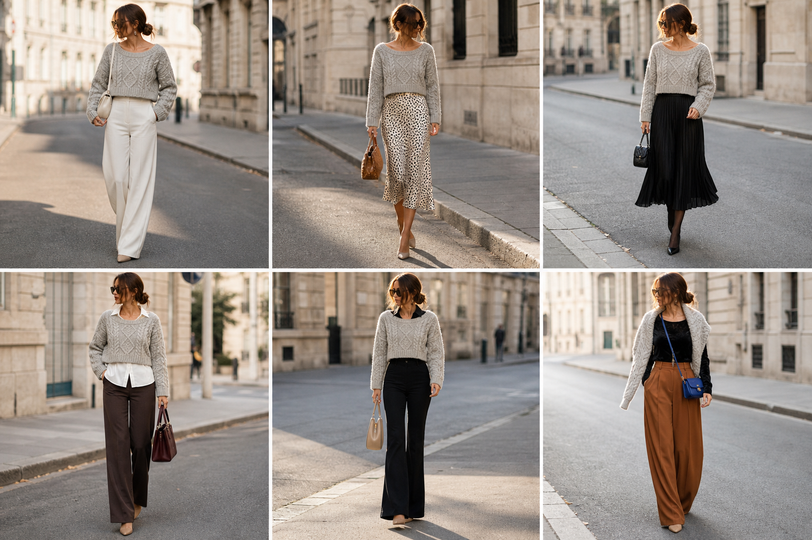

# Suéter chenille cropped (SUE-09) — jeitos de usar

Teste antes de decidir doar: gola ampla, boxy, cropped. Gerada pela API.

| # | Look | Combinação |
|---|---|---|
| 1 | Chenille cropped e off-white | CAL-03, BOL-05 |
| 2 | Chenille cropped e slip | SAI-02, BOL-02, ACE-03 |
| 3 | Chenille cropped e plissada | SAI-10, BOL-06, Meia-calça fina preta |
| 4 | Chenille cropped e camisa | CAM-10, CAL-05, BOL-01 |
| 5 | Chenille cropped e flare | CAM-05, CAL-15, BOL-08 |
| 6 | Chenille nos ombros | BLU-37, CAL-17, BOL-03 |
