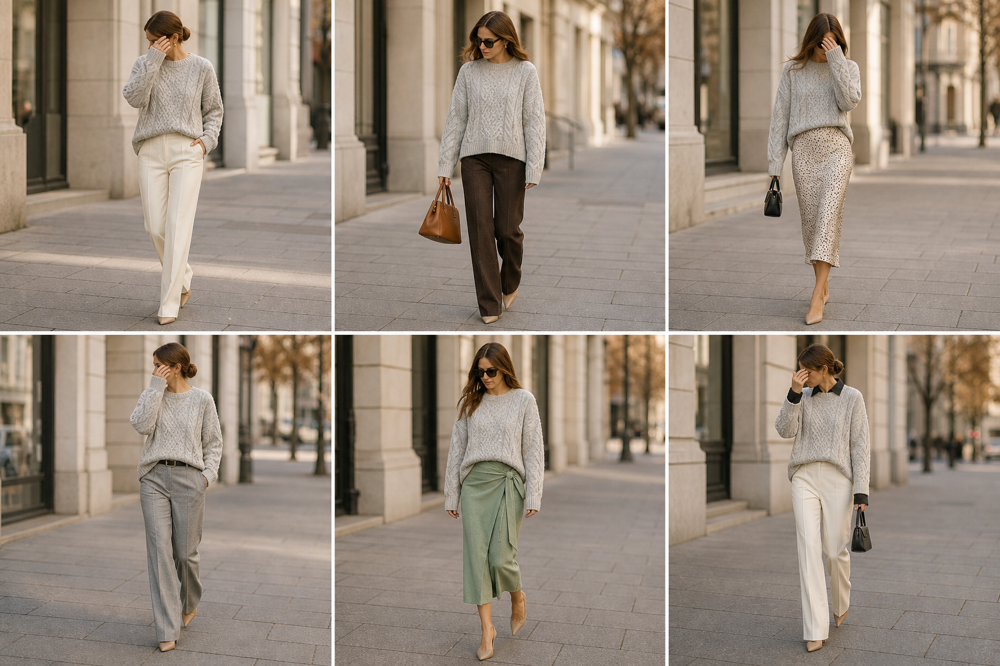

# Suéter oversized de chenille — street style

Peça âncora: **SUE-09**, com as peças dela. Gerada pela API.

| # | Look | Combinação | ⭐ |
|---|---|---|---|
| 1 | Chenille e off-white | CAL-03, ACE-03 | |
| 2 | Chenille e marrom | CAL-05, Bolsa caramelo | |
| 3 | Chenille e slip | SAI-02, Bolsa preta pequena | |
| 4 | Chenille tom sobre tom | CAL-04, ACE-02 | |
| 5 | Chenille e linho menta | SAI-03 | |
| 6 | Chenille e camisa preta | CAM-05, CAL-03, Bolsa preta pequena | |

> Removidos do app: looks com SUE-09 longo/com caimento (o real é cropped e boxy): c99-01, c97-01, c95-05, c92-01, c85-01, c74-01, c74-02, c74-03, c74-04, c74-05, c74-06. Ficaram só os de looks/2026-11-sueter-chenille-cropped.
