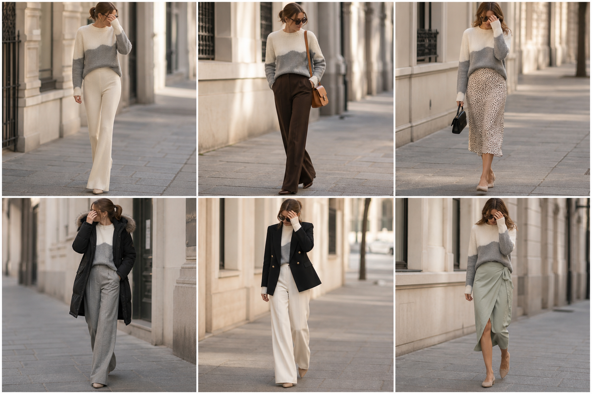

# Suéter color block (Banana Republic) — street style

Peça âncora: **SUE-13**, com as peças dela. Gerada pela API.

| # | Look | Combinação | ⭐ |
|---|---|---|---|
| 1 | Color block e flare creme | CAL-07, ACE-03 | |
| 2 | Color block e marrom | CAL-05, Bolsa caramelo | |
| 3 | Color block e slip | SAI-02, Bolsa preta pequena | |
| 4 | Color block e parka | CAS-02, CAL-04 | |
| 5 | Color block e blazer preto | BLA-05, CAL-03 | |
| 6 | Color block e linho menta | SAI-03 | |
