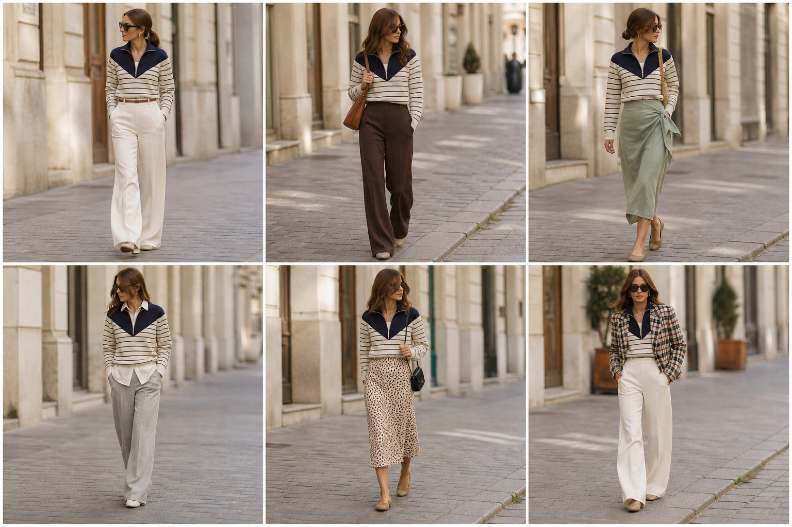

# Suéter meio-zíper listrado — street style

Peça âncora: **SUE-05**, com as peças dela. Gerada pela API.

| # | Look | Combinação | ⭐ |
|---|---|---|---|
| 1 | Listras e off-white | CAL-03, ACE-01 | |
| 2 | Listras e marrom | CAL-05, Bolsa caramelo | |
| 3 | Listras e linho menta | SAI-03, ACE-03 | |
| 4 | Listras e camisa | CAM-10, CAL-04 | |
| 5 | Listras e slip | SAI-02, Bolsa preta pequena | |
| 6 | Listras e xadrez curto | BLA-09, CAL-03 | |
