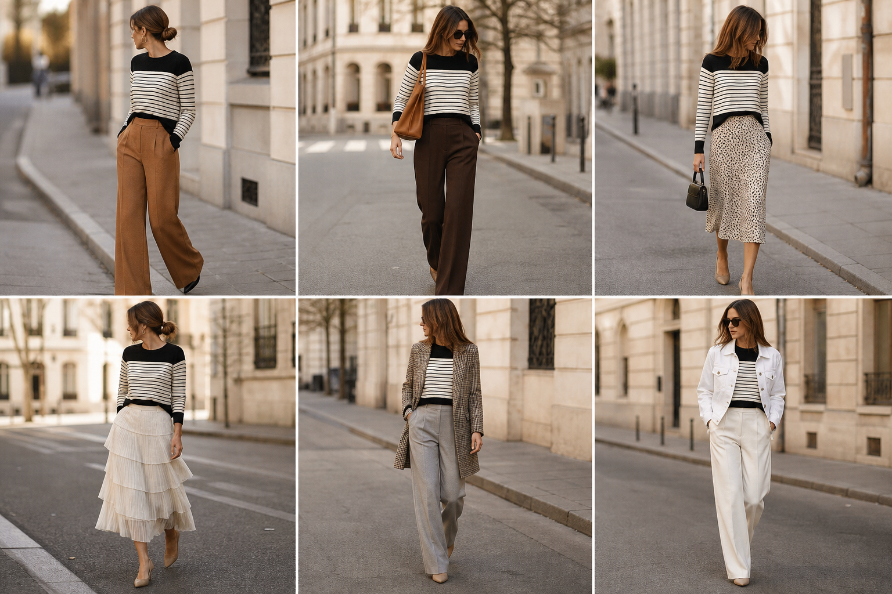

# Suéter listrado com pala preta (City) — street style

Peça âncora: **SUE-10**, com as peças dela. Gerada pela API.

| # | Look | Combinação | ⭐ |
|---|---|---|---|
| 1 | Listras e pantalona caramelo | CAL-06, ACE-03 | |
| 2 | Listras pretas e marrom | CAL-05, Bolsa caramelo | |
| 3 | Listras pretas e slip | SAI-02, Bolsa preta pequena | |
| 4 | Listras pretas e saia creme | SAI-01 | |
| 5 | Listras e pied-de-poule | BLA-06, CAL-04 | |
| 6 | Listras e jaqueta branca | JAQ-04, CAL-03 | |
