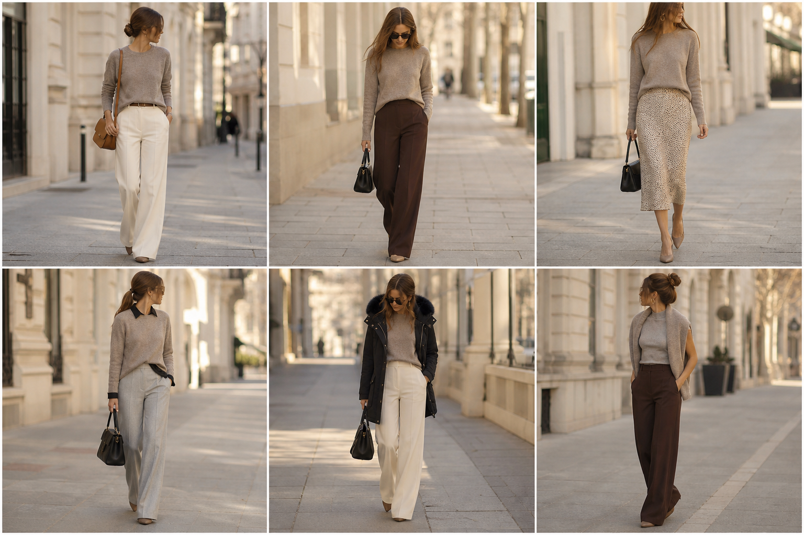

# Suéter Future Knit taupe (Insider) — street style

Peça âncora: **SUE-01**, com as peças dela. Gerada pela API.
Prompt: [prompt](../../prompts/2026-11-08-sueter-taupe-street-style.md).

| # | Look | Combinação | ⭐ |
|---|---|---|---|
| 1 | Suéter e off-white | CAL-03, ACE-01, Bolsa caramelo | |
| 2 | Suéter e marrom | CAL-05, Bolsa preta pequena | |
| 3 | Suéter e slip | SAI-02, ACE-03, Bolsa preta | |
| 4 | Suéter, camisa e cinza | CAM-05, CAL-04, Bolsa preta estruturada | |
| 5 | Suéter, parka e off-white | CAS-02, CAL-03, Bolsa preta | |
| 6 | Suéter nos ombros e marrom | BLU-18, CAL-05, ACE-03 | |
