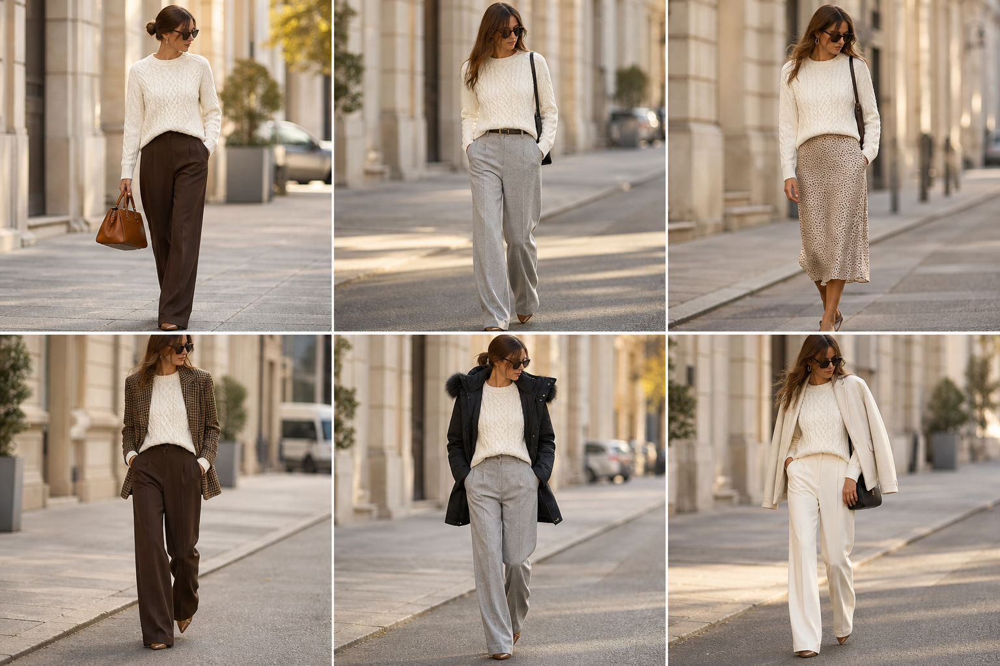

# Suéter de tranças (Anselmi) — street style

Peça âncora: **SUE-08**, com as peças dela. Gerada pela API.

| # | Look | Combinação | ⭐ |
|---|---|---|---|
| 1 | Tranças e marrom | CAL-05, Bolsa caramelo | |
| 2 | Tranças e cinza | CAL-04, ACE-02 | |
| 3 | Tranças e slip | SAI-02, ACE-03 | |
| 4 | Tranças e pied-de-poule | BLA-06, CAL-05 | |
| 5 | Tranças e parka | CAS-02, CAL-04 | |
| 6 | Tranças e couro branco | JAQ-08, CAL-03, Bolsa preta pequena | |
