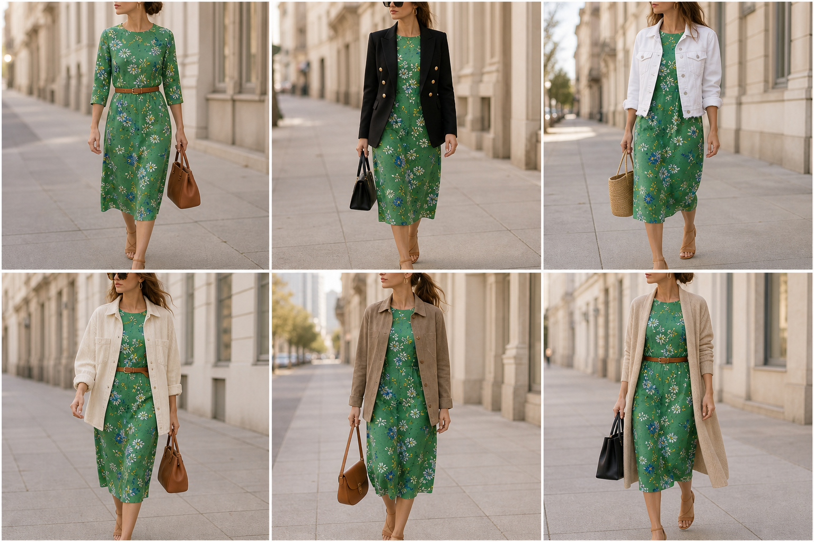

# Vestido floral verde (Ralph Lauren) — street style

Peça âncora: **VES-03**, com as peças dela. Gerada pela API. Obs.: a estampa saiu mais miúda que a real.

| # | Look | Combinação | ⭐ |
|---|---|---|---|
| 1 | Floral e cinto | ACE-01, ACE-03, Bolsa caramelo | |
| 2 | Floral e blazer | BLA-05, Bolsa preta estruturada | |
| 3 | Floral e jeans branca | JAQ-04, Bolsa de palha | |
| 4 | Floral e cotelê | JAQ-06, ACE-01 | |
| 5 | Floral e camurça | JAQ-03, Bolsa caramelo | |
| 6 | Floral e casaco bege | CAS-03, ACE-01, Bolsa preta | |
