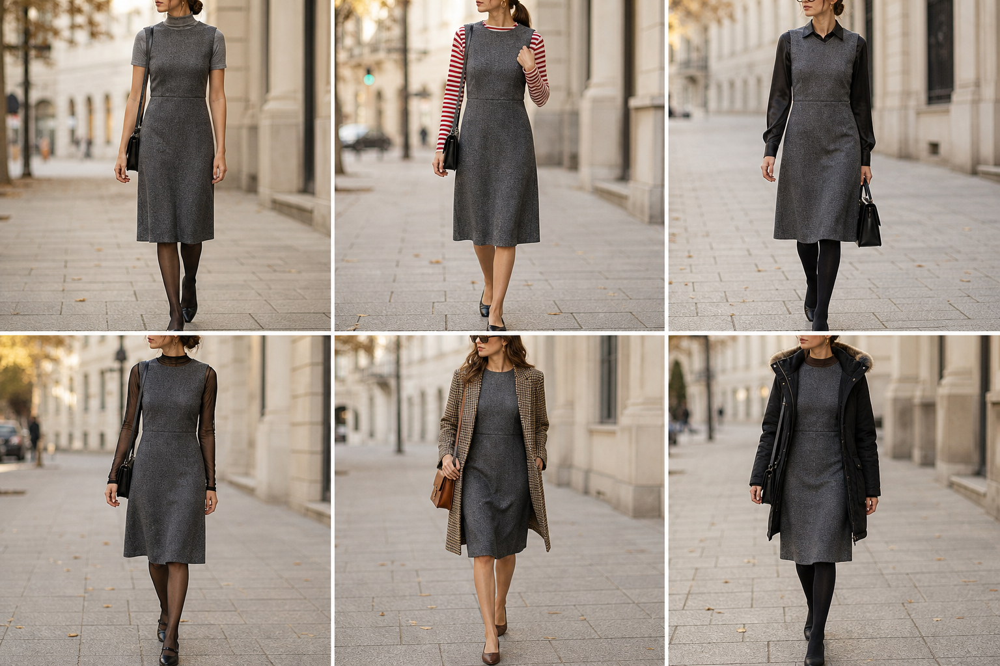

# Vestido sem manga de lã cinza chumbo — street style

Peça âncora: **VES-01**, com as peças dela. Gerada pela API.

| # | Look | Combinação | ⭐ |
|---|---|---|---|
| 1 | Vestido e gola alta cinza | BLU-18, Meia-calça preta fina, Bolsa preta | |
| 2 | Vestido e listrada | BLU-10, ACE-03, Bolsa preta pequena | |
| 3 | Vestido e acetinada | CAM-05, Meia-calça preta opaca, Óculos de grau | |
| 4 | Vestido e tule | BLU-16, Meia-calça preta fina | |
| 5 | Vestido e pied-de-poule | BLA-06, Bolsa caramelo | |
| 6 | Vestido, tricô e parka | BLU-15, CAS-02, Meia-calça preta opaca | |

> Removidos do app (12 looks com VES-01: c30-01..06, c33-05, c38-06, c41-06, c47-05, c48-05, c56-06): saíram longos e com decote errado; o vestido é curto, acima do joelho, gola redonda alta.
