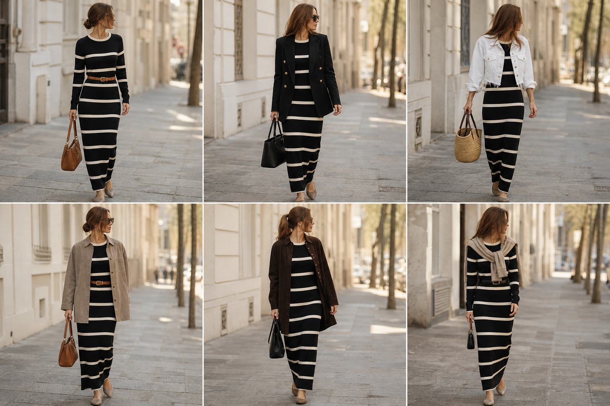

# Vestido longo de tricô listrado (Viviane Furrier) — street style

Peça âncora: **VES-05**, com as peças dela. Gerada pela API. Obs.: listras saíram mais finas e numerosas que as reais.

| # | Look | Combinação | ⭐ |
|---|---|---|---|
| 1 | Listrado e cinto | ACE-01, ACE-03, Bolsa caramelo | |
| 2 | Listrado e blazer | BLA-05, Bolsa preta estruturada | |
| 3 | Listrado e jeans branca | JAQ-04, Bolsa de palha | |
| 4 | Listrado e camurça | JAQ-03, ACE-01 | |
| 5 | Listrado e casaco marrom | CAS-04, Bolsa preta | |
| 6 | Listrado e suéter | SUE-01, ACE-02, Bolsa preta pequena | |
