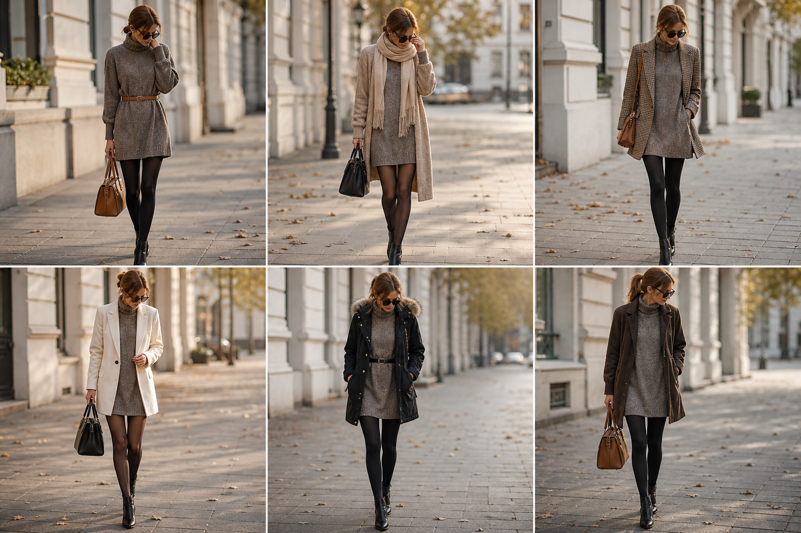

# Vestido-suéter curto de tricô (Zara) — street style

Peça âncora: **VES-02** (substitui o cadastro errado anterior), com as peças dela. Gerada pela API.

| # | Look | Combinação | ⭐ |
|---|---|---|---|
| 1 | Vestido-suéter e cinto | ACE-01, Meia-calça preta opaca, Bolsa caramelo | |
| 2 | Vestido-suéter e casaco bege | CAS-03, Meia-calça preta fina | |
| 3 | Vestido-suéter e pied-de-poule | BLA-06, Meia-calça preta opaca | |
| 4 | Vestido-suéter e blazer off-white | BLA-08, Meia-calça preta fina | |
| 5 | Vestido-suéter e parka | CAS-02, ACE-02, Meia-calça preta opaca | |
| 6 | Vestido-suéter e casaco marrom | CAS-04, Meia-calça preta opaca | |
