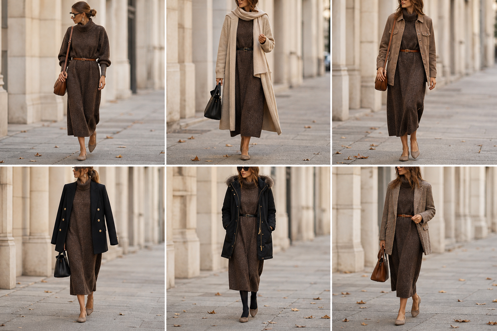

# Vestido de tricô marrom gola alta — street style

Peça âncora: **VES-02**, com as peças dela. Gerada pela API.

| # | Look | Combinação | ⭐ |
|---|---|---|---|
| 1 | Vestido tricô e cinto | ACE-01, ACE-03, Bolsa caramelo | |
| 2 | Vestido tricô e casaco bege | CAS-03, ACE-02, Bolsa preta | |
| 3 | Vestido tricô e camurça | JAQ-03, ACE-01 | |
| 4 | Vestido tricô e blazer | BLA-05, Bolsa preta estruturada | |
| 5 | Vestido tricô e parka | CAS-02, ACE-02, Meia-calça preta opaca | |
| 6 | Vestido tricô e pied-de-poule | BLA-06, ACE-01, Bolsa caramelo | |
